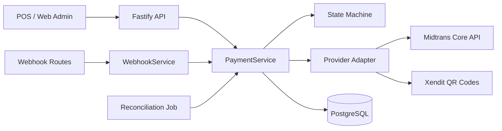

# Payment Gateway Architecture

## Goals

- Provider-neutral payment domain (order module tidak bergantung Midtrans/Xendit).
- Multi-tenant isolation di backend (tenant/outlet dari JWT, bukan body klien).
- Failure payment service tidak mem-block modul order (transaksi DB terpisah + outbox worker).

## Components

## Adapter interface

Setiap provider mengimplementasikan:

- `createPayment`, `getPaymentStatus`, `cancelPayment`, `refundPayment`
- `verifyWebhook`, `parseWebhookEvent`, `normalizeProviderStatus`
- `capabilities()` — mendeteksi fitur yang tidak didukung

Provider aktif dipilih via `PAYMENT_PROVIDER` (default tenant-level; override per-request untuk QRIS non-cash).

## Data model

Tabel utama: `payments`, `payment_attempts`, `payment_events`, `payment_webhook_events`, `payment_refunds`, `payment_reconciliations`, `payment_settlements`, `idempotency_records`, `transactional_outbox`.

Settlement merchant dipisah dari status pembayaran pelanggan (`settlement_status`).
