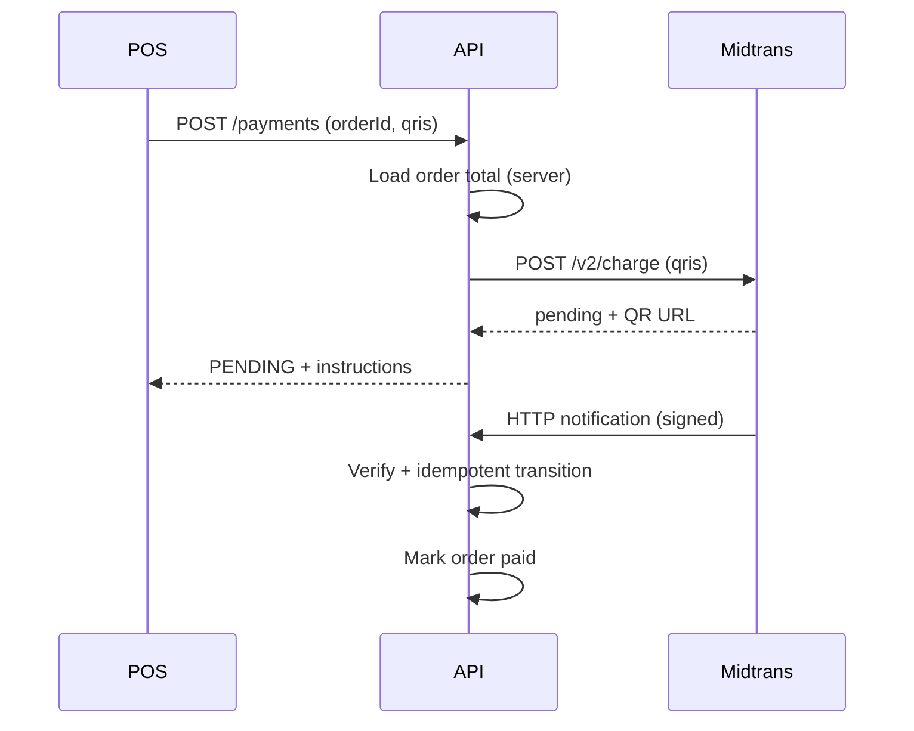

# Payment Lifecycle

## Internal statuses

`CREATED`, `PENDING`, `SUCCEEDED`, `FAILED`, `EXPIRED`, `CANCELLED`, `UNKNOWN`, `REFUND_PENDING`, `PARTIALLY_REFUNDED`, `REFUNDED`.

## Rules

1. `SUCCEEDED` hanya dari webhook terverifikasi, inquiry provider, atau cash sync tervalidasi.
2. `PENDING` ≠ paid.
3. Timeout inquiry → `UNKNOWN`, bukan `FAILED`.
4. Transisi divalidasi (`state-machine.ts`); event lama tidak menurunkan status kuat tanpa aturan.
5. Semua transisi dicatat di `payment_events`.
6. **Verified:** `applyStatusTransition` locks the payment row and re-reads the current status before applying provider/API events (prevents stale webhooks from downgrading `SUCCEEDED`).
7. **Verified:** At most one *active* payment per order (`CREATED` / `PENDING` / `UNKNOWN`) — API guard + partial unique index `payments_one_active_per_order_uidx`.

## Allowed transitions (summary)

Source of truth: `ALLOWED_TRANSITIONS` in `apps/api/src/modules/payment/state-machine.ts`.

Notable behaviors (verified in unit tests):

- `SUCCEEDED` → `PENDING` / `FAILED` / `CREATED` is **rejected** (rank / allow-list).
- `FAILED` → `PENDING` is **allowed** (provider retry path — assumption: provider may re-open a failed attempt).
- `REFUNDED` and `CANCELLED` are terminal (no outbound transitions).
- Duplicate webhook deliveries with the same `provider_event_id` are **no-ops** after the first processed row.

## Sequence — QRIS (Midtrans)

