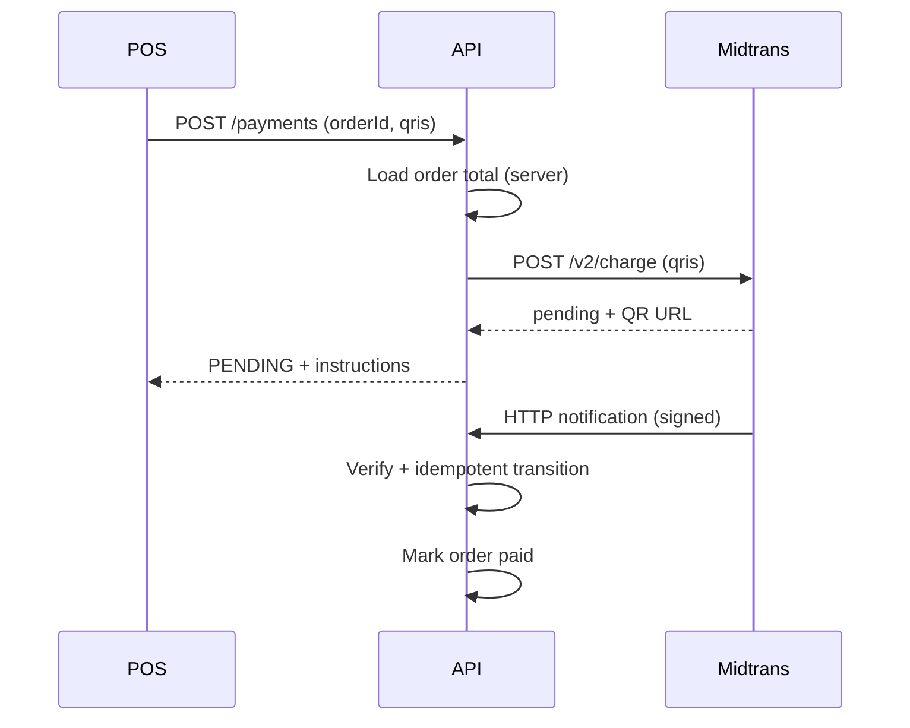

# Payment Lifecycle

## Internal statuses

`CREATED`, `PENDING`, `SUCCEEDED`, `FAILED`, `EXPIRED`, `CANCELLED`, `UNKNOWN`, `REFUND_PENDING`, `PARTIALLY_REFUNDED`, `REFUNDED`.

## Rules

1. `SUCCEEDED` hanya dari webhook terverifikasi, inquiry provider, atau cash sync tervalidasi.
2. `PENDING` ≠ paid.
3. Timeout inquiry → `UNKNOWN`, bukan `FAILED`.
4. Transisi divalidasi (`state-machine.ts`); event lama tidak menurunkan status kuat tanpa aturan.
5. Semua transisi dicatat di `payment_events`.

## Sequence — QRIS (Midtrans)

